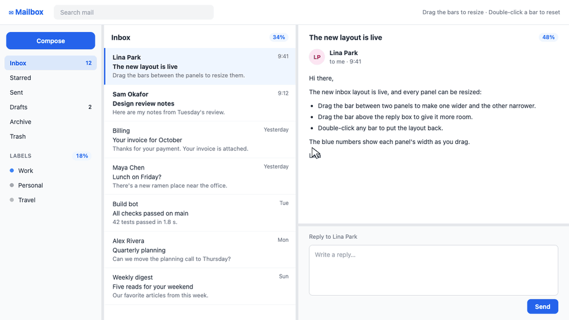

# react-sash

Resizable split panes for React: drag the bar between two panels to resize them.

[](https://www.npmjs.com/package/react-sash)
[](./LICENSE)



- **Any number of panes**, side by side or stacked. Nest them for more complex layouts.
- **Drag** with mouse, touch or pen. **Double-click** a divider to reset.
- **Controlled or uncontrolled.** Keep the sizes in your own state to save and restore them.
- **Small:** one component, no dependencies, under 1 kB of JavaScript gzipped.
- **Easy to theme:** three CSS variables, and styles with zero specificity that your own classes override.
- Works with **React 18 and 19** and the **Next.js App Router** (`'use client'` included). TypeScript types included.

## Install

```bash
npm install react-sash
```

## Quick start

```tsx
import { Sash } from 'react-sash';
import 'react-sash/styles.css';

export function App() {
  return (
    <div style={{ height: '100vh' }}>
      <Sash>
        <nav>Sidebar</nav>
        <main>Content</main>
      </Sash>
    </div>
  );
}
```

`Sash` puts a divider between every two children. It fills its parent, so **the parent needs a height**.

## Examples

### Nested layouts

Put one `Sash` inside another. This is the mailbox in the demo above:

```tsx
<Sash defaultSizes={[18, 34, 48]}>
  <Folders />
  <MessageList />

  <Sash direction="vertical" defaultSizes={[68, 32]}>
    <Message />
    <ReplyBox />
  </Sash>
</Sash>
```

### Remember the layout

Pass `sizes` and `onSizesChange` to keep the sizes in your own state, for example in `localStorage`:

```tsx
const [sizes, setSizes] = useState<number[]>(
  () => JSON.parse(localStorage.getItem('layout') ?? '[25, 75]'),
);

<Sash
  sizes={sizes}
  onSizesChange={(next) => {
    setSizes(next);
    localStorage.setItem('layout', JSON.stringify(next));
  }}
>
  <Sidebar />
  <Editor />
</Sash>
```

### Show and hide a pane

`null`, `false` and `undefined` children are skipped, so a pane can be conditional. When the number of
panes changes, the sizes start over: from `defaultSizes` if it has one size per pane, otherwise equal
sizes. Here the editor gets 100% while the sidebar is hidden:

```tsx
<Sash defaultSizes={[25, 75]}>
  {showSidebar && <Sidebar />}
  <Editor />
</Sash>
```

### Keep panes from getting too small

`min` is the smallest size of any pane, in percent. The default is `10`.

```tsx
<Sash min={20}>…</Sash>
```

## API

### `<Sash>`

Sizes are percentages, one per pane, in order. Dragging a divider only changes the two panes next to it.

| Prop            | Type                         | Default        | Description                                                         |
|-----------------|------------------------------|----------------|---------------------------------------------------------------------|
| `children`      | `ReactNode`                  |                | The panes, left to right or top to bottom.                          |
| `direction`     | `'horizontal' \| 'vertical'` | `'horizontal'` | `horizontal`: side by side. `vertical`: stacked.                    |
| `defaultSizes`  | `number[]`                   | equal sizes    | Starting sizes. Double-clicking a divider resets to them.           |
| `sizes`         | `number[]`                   |                | Current sizes, for a controlled split. Use with `onSizesChange`.    |
| `onSizesChange` | `(sizes: number[]) => void`  |                | Called with every pane's size whenever the user resizes.            |
| `min`           | `number`                     | `10`           | Smallest size of any pane.                                          |
| `dividerLabel`  | `string`                     | `'Resize'`     | Accessible name of the dividers, e.g. `"Resize sidebar"`.           |

Every other prop (`className`, `style`, `id`, `data-*`, event handlers, `ref`…) goes to the outer `<div>`.

The types `SashProps` and `SashDirection` are exported too.

## Styling

Set these CSS variables on `:root` or on any element around the split:

```css
:root {
  --sash-divider-size: 6px;              /* thickness of the bar */
  --sash-divider-color: #3c3c3c;         /* bar color */
  --sash-divider-active-color: #0078d4;  /* while hovered or dragged */
}
```

The built-in styles have zero specificity, so any class of your own overrides them:

| Class                | Element                               |
|----------------------|---------------------------------------|
| `sash`               | Outer container                       |
| `sash--horizontal`   | Outer container, panes side by side   |
| `sash--vertical`     | Outer container, panes stacked        |
| `sash--dragging`     | Outer container, while dragging       |
| `sash__pane`         | Each pane                             |
| `sash__divider`      | Each bar between two panes            |

For example, thin light bars that fade to blue on hover:

```css
:root {
  --sash-divider-size: 4px;
  --sash-divider-color: #e5e7eb;
  --sash-divider-active-color: #3b82f6;
}
.sash__divider {
  transition: background-color 0.15s 0.1s;
}
```

## Good to know

- **Scrolling:** each pane scrolls on its own. To make a child fill its whole pane (for a background
  color, say), give it `min-height: 100%`.
- **Keyboard:** dividers are moved with a mouse, touch or pen only. They can't be focused or moved
  with the keyboard.
- **Server rendering:** the first render uses `defaultSizes`, so the server and client match.

## Development

```bash
npm install
npm run dev        # the mailbox demo at http://localhost:5173
npm test
npm run typecheck
npm run build      # compiles src/ to dist/
```

The GIF at the top of this README is a recording of that demo (`example/main.tsx`).

## License

MIT
# react-sash
